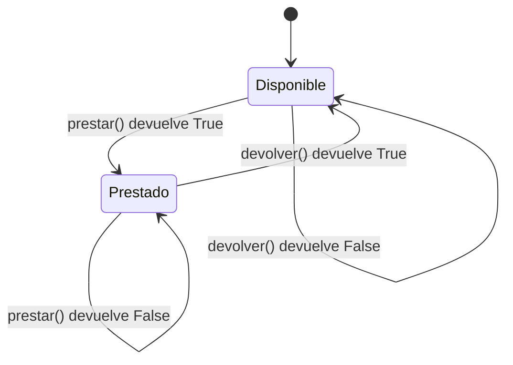
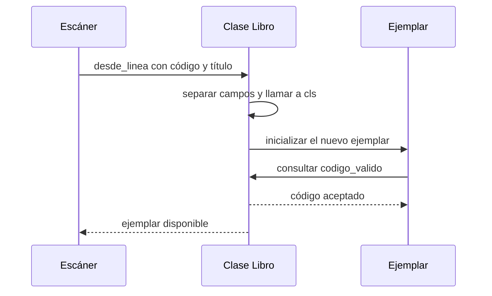

# 01 · Del préstamo al alta de ejemplares

**Taller de 3 h 30 min · 8 ejercicios encadenados.** Recupera la biblioteca del ejercicio 18 y localiza la clase `Libro` que empezaste a construir en los ejercicios 12 y 13. Conserva una copia del programa para comparar las dos versiones.

[Dos ejemplares](#1-dos-ejemplares) · [El problema del menú](#2-el-problema-del-menú) · [Una propiedad de lectura](#3-una-propiedad-de-lectura) · [Códigos](#4-el-control-de-etiquetas) · [Altas](#5-un-alta-desde-el-escáner) · [Ciclo de vida](#6-el-ejemplar-que-sigue-vivo) · [Finalización](#7-el-testigo-del-inventario) · [Integración](#8-turno-de-biblioteca)

Al terminar podrás explicar a qué ejemplar se refiere `self`, distinguir el resultado de una operación del estado que deja y modificar la clase sin cambiar la forma en que el menú consulta la disponibilidad.

Durante el taller ampliarás la misma clase para dar de alta libros desde un escáner. Para los experimentos de ciclo de vida usarás una clase auxiliar. Guarda tus predicciones antes de ejecutar cada experimento. Puedes consultar los apartados 2 a 4 del [manual de POO](README.md).

## 1. Dos ejemplares

**Primeros 10 minutos.** Añade estas líneas al programa de prueba que utiliza tu clase. Antes de ejecutarlas, escribe qué cinco valores booleanos esperas ver.

```python
a = Libro("L01", "Dune")
b = Libro("L02", "Dune")
print(a.prestar(), a.disponible)
print(a.prestar(), a.disponible)
print(b.disponible)
```

La salida es `True False`, después `False False` y finalmente `True`. El primer valor de cada pareja responde a «¿se ha realizado este préstamo?». El segundo responde a «¿está disponible ahora?». Al ejecutar `a.prestar()`, el parámetro `self` recibe el objeto asociado a `a`. Aunque ambos ejemplares tienen el mismo título, cada uno conserva su propio estado. Predice qué cambiaría si sustituyeras la segunda construcción por `b = a`.

## 2. El problema del menú

**15 minutos en parejas.** Imagina que una nueva opción del menú contiene estas líneas después de prestar el ejemplar L01:

```python
a.disponible = True
print(a.prestar())
```

Con la clase original aparece `True`. ¿Qué devolución registró el programa entre ambos préstamos? Busca en tu aplicación las apariciones de `disponible`. Distingue las consultas de las asignaciones y anota qué clase debería decidir si se acepta una operación.



Recorre el diagrama con un dedo mientras otra persona lee la secuencia «prestar, prestar, devolver, devolver». Las flechas que vuelven al mismo estado representan intentos rechazados. Una simple consulta de disponibilidad deja el ejemplar tal como estaba.

## 3. Una propiedad de lectura

**25 minutos de implementación.** Conserva los nombres públicos que usa el menú. En la clase, guarda el estado en `self._disponible`. El guion bajo indica por convenio que ese atributo es interno. Coloca `@property` sobre el método que consulta ese dato. Así el menú puede seguir escribiendo `libro.disponible`, sin paréntesis. Al definir únicamente la lectura de la propiedad, una asignación a `libro.disponible` producirá `AttributeError`.

Intenta el cambio antes de consultar el modelo. Conserva los demás métodos de tu aplicación, incluido `resumen()` si ya lo utilizas.

<details>
<summary>Comparar con una implementación mínima</summary>

```python
class Libro:
    def __init__(self, codigo, titulo):
        self.codigo = codigo
        self.titulo = titulo
        self._disponible = True

    @property
    def disponible(self):
        return self._disponible

    def prestar(self):
        if not self.disponible:
            return False
        self._disponible = False
        return True

    def devolver(self):
        if self.disponible:
            return False
        self._disponible = True
        return True
```

</details>

Abre el menú, presta un ejemplar y consulta su ficha dos veces. Intenta prestarlo de nuevo y después devuélvelo. Si consultar la ficha altera el resultado del segundo préstamo, revisa qué método llama la opción de consulta. Aquí puedes observar la **ortogonalidad** de estas operaciones: consultar la disponibilidad y tramitar el préstamo tienen responsabilidades distintas y puedes combinarlas sin que una consulta introduzca un cambio de estado.

**Dos errores que merece la pena provocar.** En una copia de prueba escribe `self.disponible = True` en el inicializador. ¿Por qué falla ya al crear el ejemplar? Después restaura esa línea y cambia el cuerpo de la propiedad por `return self.disponible`. Sigue las dos primeras llamadas para explicar el `RecursionError` y recupera la lectura del atributo interno.

**Experimento de encapsulación.** En un ejemplar de prueba, intenta primero `a.disponible = False` y anota la excepción. En una ejecución independiente, prueba `a._disponible = False` y consulta la propiedad. Explica por qué esta segunda asignación funciona y qué operación del menú has evitado. En Python, el prefijo `_` comunica un convenio de uso interno. Restaura el ejemplar antes de seguir.

## 4. El control de etiquetas

**25 minutos · Método estático.** El escáner del centro lee etiquetas desde L01 hasta L99. Antes de dar de alta ningún libro queremos poder consultar `Libro.codigo_valido(texto)`. Implementa el método con `@staticmethod`. Recibe una cadena y devuelve un booleano. Exige una L mayúscula y exactamente dos cifras ASCII, con un número del 01 al 99. En este método, los espacios cuentan como caracteres.

| Entrada | Resultado | Motivo |
|---|---|---|
| `"L01"`, `"L99"` | True | Límites admitidos |
| `"L00"`, `"L1"`, `"L001"` | False | Número o longitud fuera de rango |
| `"l03"`, `" L03"`, `"L٣٤"`, `""` | False | Formato distinto del acordado |

1. Convierte la tabla en comprobaciones. Ejecuta al menos una sin crear ningún objeto.
2. Llama al mismo validador desde `__init__`. Si el código es inválido, lanza `ValueError`. Rechaza también un título vacío o formado únicamente por espacios. Guarda el título sin espacios exteriores.
3. Comprueba que `Libro("L00", "Dune")` falla y que `Libro("L01", " Dune ").titulo == "Dune"`. Explica qué datos necesitaría el método para comprobar además si el código ya está ocupado. ¿Qué objeto dispone de ellos?

**Pista.** Puedes comprobar cada carácter con `c in "0123456789"`. La operación de validación solo necesita su argumento. Esto permite probarla por separado y usar la misma regla en todas las vías de alta.

## 5. Un alta desde el escáner

**35 minutos · Método de clase.** El escáner entrega una línea como `" L08 ; Dune "`. Queremos obtener el mismo ejemplar que al escribir `Libro("L08", "Dune")`. Diseña `Libro.desde_linea(linea)` como constructor alternativo.

1. Decláralo con `@classmethod` y recibe `cls` como primer parámetro. Separa la línea por el **primer** punto y coma. Conserva los demás como parte del título.
2. Limpia los extremos de los campos y devuelve `cls(codigo, titulo)`. Delega la validación de código y título en el inicializador. Una línea sin separador debe producir `ValueError`.
3. Comprueba que `"L09; Python; casos prácticos"` conserva el título completo. Prueba también `"L10"`, `"L00;Dune"` y `"L10;  "`. Anota qué paso rechaza cada entrada.



**Prueba de diseño.** Añade debajo de tu clase el siguiente fragmento. La clase de prueba hereda la implementación de `Libro`. Predice el resultado de la última línea, ejecútala y cambia temporalmente `return cls(...)` por `return Libro(...)`. ¿Qué observas? Recupera la versión con `cls`.

```python
class LibroDeSala(Libro):
    pass

ejemplar = LibroDeSala.desde_linea("L11;Atlas")
print(type(ejemplar).__name__)
```

| Llamada | Pregunta para justificar la elección |
|---|---|
| `ejemplar.prestar()` | ¿De qué ejemplar concreto cambia el estado? |
| `Libro.desde_linea(texto)` | ¿Qué clase debe construir el resultado si la llamada procede de una subclase? |
| `Libro.codigo_valido(texto)` | ¿Qué información hay que conocer aparte del texto? |

## 6. El ejemplar que sigue vivo

**20 minutos · Identidad y referencias.** Al construir un objeto ordinario, `__new__` crea la instancia y `__init__` inicializa sus atributos. Después, distintos nombres y colecciones pueden referirse a la misma instancia. La biblioteca ha retirado una etiqueta de pantalla y quiere saber si también ha desaparecido el ejemplar.

```python
libro = Libro("L14", "Atlas")
inventario = [libro]
mostrador = libro
del libro
mostrador.prestar()
print(inventario[0].disponible)
del mostrador
print(inventario[0].titulo)
```

Antes de ejecutar, dibuja las flechas hacia el objeto justo antes de `del libro`, justo después y tras `del mostrador`. Incluye el elemento de la lista. Predice las dos salidas y comprueba si coinciden. Finalmente ejecuta `inventario.clear()` y explica qué referencia desaparece. ¿En qué paso se ejecutó `__init__` y cuántas veces? ¿En qué paso dejó de estar disponible para préstamo?

## 7. El testigo del inventario

**30 minutos · Inicialización y finalización.** Instrumenta una clase pequeña para observar el ciclo de vida sin introducir mensajes de depuración en el menú. En la terminología del módulo, el destructor se estudia mediante el **finalizador** `__del__`.

1. Crea en un archivo independiente la clase `Testigo`. En `__init__(self, codigo)`, guarda el código e imprime `Alta L20` cuando el código sea L20. En `__del__(self)`, imprime `Fin L20` usando el código de la instancia.
2. Ejecuta el guion inferior como un programa completo. Predice en qué tramo **puede** aparecer «Fin L20» y en cuál sigue habiendo una referencia que lo impide.

```python
testigo = Testigo("L20")
caja = [testigo]
del testigo
print("A: la caja conserva", caja[0].codigo)
caja.clear()
print("B: la caja está vacía")
```

3. Repite creando `copia = caja[0]` antes de vaciar la caja y añade `print(copia.codigo)` y `del copia` al final. Entrega ambas trazas y señala qué explica la diferencia.
4. Un compañero propone registrar la devolución de un préstamo en `__del__`. Describe qué ocurriría si la biblioteca conserva el ejemplar en su catálogo durante todo el curso. Indica la operación explícita que debería registrar la devolución.

**Cómo interpretar el experimento.** `del` elimina la referencia indicada. CPython suele ejecutar el finalizador de un objeto sencillo en cuanto desaparece su última referencia. El momento exacto depende del intérprete y no se garantiza la finalización de todos los objetos al cerrar el programa. Evalúa tu predicción por las referencias que siguen vivas. Para cerrar recursos en un momento definido se utiliza un mecanismo explícito, por ejemplo `with` para ficheros.

## 8. Turno de biblioteca

**50 minutos · Integración y entrega individual.** Añade al menú del ejercicio 18 la opción «Alta desde escáner». Lee una línea, construye el ejemplar con el método de clase e incorpóralo a la colección que ya utiliza tu biblioteca. Si la entrada produce `ValueError`, informa del motivo y permite continuar. Comprueba los duplicados por código antes de incorporar el ejemplar. La colección debe conservar los libros que ya contiene tras un intento fallido.

Empieza con el catálogo vacío y registra el resultado de esta prueba de aceptación:

| Paso | Acción en el menú | Resultado observable |
|---|---|---|
| 1 | Alta de `L21;Dune` y de `L22;Dune` | Dos ejemplares disponibles con el mismo título |
| 2 | Alta de `L21;Otro título` y después de `L00;Atlas` | Ambos intentos se rechazan y quedan los dos títulos originales |
| 3 | Prestar L21, consultar su ficha dos veces y volver a prestarlo | Primer intento aceptado, segundo rechazado. L22 continúa disponible |
| 4 | Devolver L21 dos veces | Primera devolución aceptada y segunda rechazada |
| 5 | Alta de `L23;Atlas; edición escolar` | Tercer ejemplar disponible con el título completo |

**Entrega.** Presenta el programa, las comprobaciones del validador, la prueba de la subclase y las dos trazas del testigo. Adjunta el diagrama de referencias del ejercicio 6. En la demostración, elige un intento rechazado del menú y explica qué parte del programa detectó el problema y por qué el resto del inventario siguió intacto.

**Qué se evalúa.** En RA1, el diagrama y las trazas permiten explicar identidad, instancias, inicialización y finalización. Las consultas repetidas permiten explicar la ortogonalidad y la tabla del escáner sirve para justificar los tres tipos de método. En RA2, el código muestra el uso de atributos y `self`, la construcción de objetos, el finalizador y la encapsulación de las reglas de préstamo.

<details>
<summary>Autocorrección tras la entrega</summary>

- **Referencias.** El ejercicio 6 imprime `False` y `Atlas`. Los tres nombres o accesos iniciales conducen a una única instancia. El préstamo cambia su estado. Borrar un nombre deja intacta la referencia de la lista.
- **Escáner.** El método de clase crea un `LibroDeSala` cuando recibe esa clase en `cls`. Escribir `Libro(...)` en su lugar fija el tipo del resultado. La validación estática puede ejecutarse antes de construir ningún ejemplar.
- **Finalizador.** En el primer guion, la caja mantiene vivo el testigo durante la impresión de A. En el segundo, la referencia adicional sigue siendo válida después de B. Una prueba portable puede comprobar ese acceso sin exigir que el mensaje de finalización aparezca en un instante exacto.
- **Reparto de reglas.** El libro conoce su estado y el formato de su código. La biblioteca conoce los códigos que ya se han registrado. El menú presenta el resultado al usuario.

</details>
