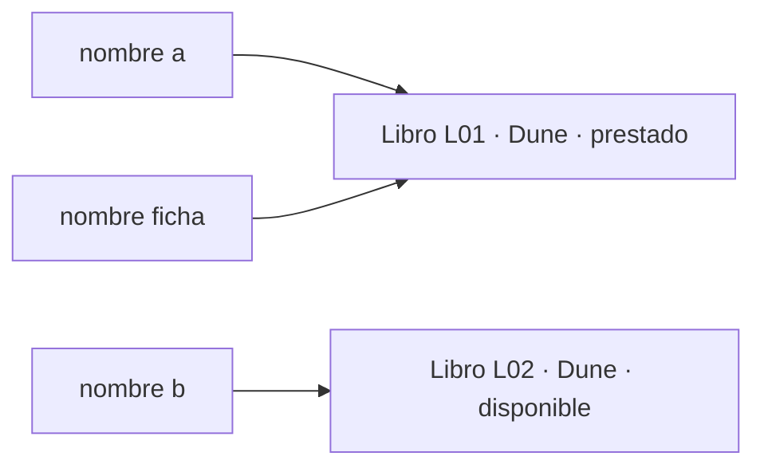
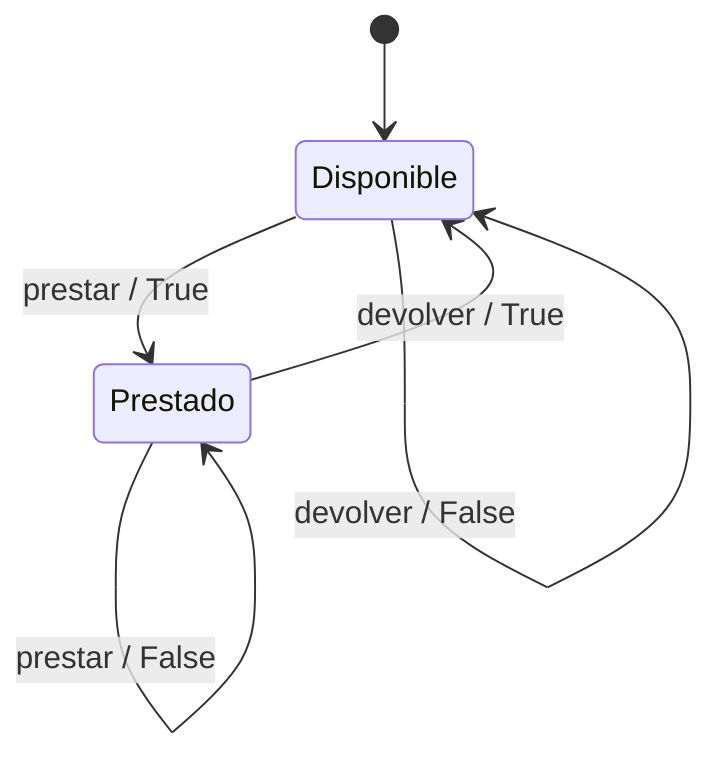
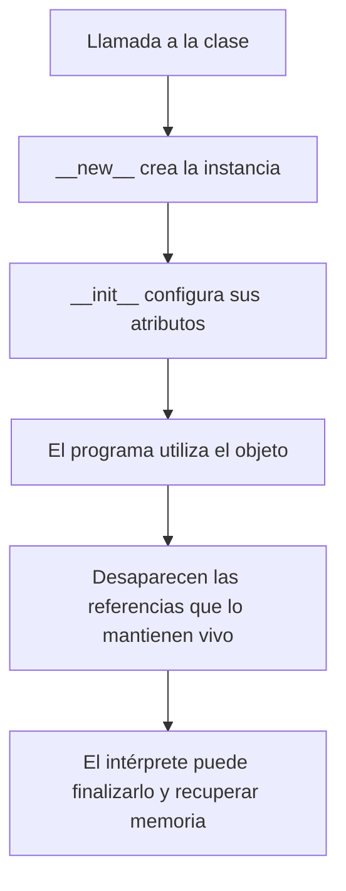
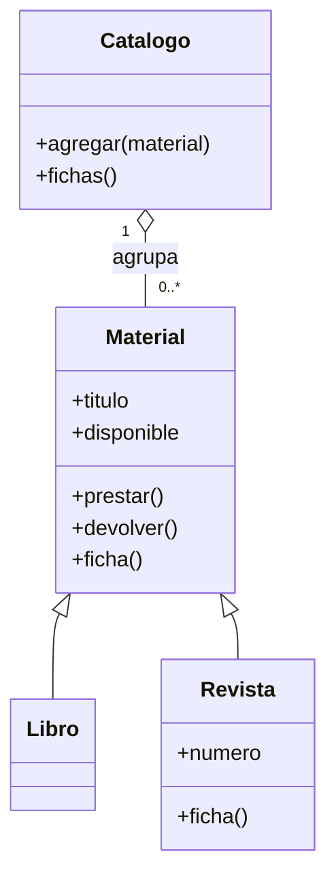
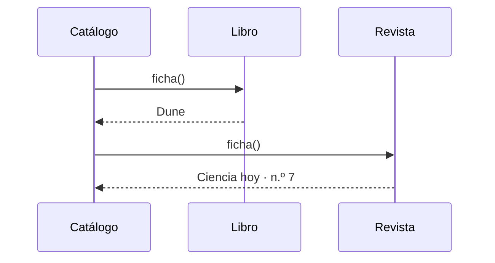

# Programación orientada a objetos en Python · RA1 y RA2

**Manual de consulta para el alumnado · Módulo 5100.** Una biblioteca compra dos ejemplares de la misma novela. Un lector se lleva uno. ¿Qué dato cambia? ¿Qué objeto debe cambiarlo? ¿Cómo hacemos que el catálogo siga funcionando cuando la biblioteca empieza a prestar revistas? Estas preguntas guían los ejemplos.

**Cómo usar los ejemplos.** Cada bloque Python es independiente y se puede ejecutar en un archivo vacío con Python 3.10 o posterior. La última sección es un proyecto de varios archivos. Las líneas que empiezan por `#` indican el resultado esperado o explican una decisión. Un `assert` comprueba una condición: si se cumple, el programa continúa en silencio.

| Quiero entender… | Ir a |
|---|---|
| Objeto, clase, instancia, identidad, atributos y referencias | [1. Dos ejemplares](#1-dos-ejemplares) |
| Métodos, self, encapsulación y ortogonalidad | [2. Quién cambia el estado](#2-quién-cambia-el-estado) |
| Métodos de instancia, de clase y estáticos | [3. Tres tipos de métodos](#3-tres-tipos-de-métodos) |
| Construcción, inicialización y finalización | [4. Vida de un objeto](#4-vida-de-un-objeto) |
| Herencia, sobrescritura, super y composición | [5. Reutilizar una clase](#5-reutilizar-una-clase) |
| Polimorfismo y selección del método | [6. Un mensaje y varias respuestas](#6-un-mensaje-y-varias-respuestas) |
| Módulos, paquetes e importaciones | [7. Una aplicación organizada](#7-una-aplicación-organizada) |

## 1. Dos ejemplares

Una **clase** define un tipo de objeto. Al llamar a la clase se obtiene una **instancia**. Un objeto tiene identidad (qué objeto es), estado (qué valores guarda ahora) y comportamiento (qué operaciones ofrece). En nuestro modelo cada instancia representa un ejemplar físico. El título puede repetirse. El código de inventario permite al personal distinguir ejemplares y es un dato del dominio. Python distingue los objetos por su identidad incluso si todos sus datos coinciden.

```python
class Libro:
    tipo = "material impreso"       # atributo compartido de la clase

    def __init__(self, codigo, titulo):
        self.codigo = codigo        # atributo propio de cada instancia
        self.titulo = titulo
        self.disponible = True

a = Libro("L01", "Dune")
b = Libro("L02", "Dune")
ficha = a
ficha.disponible = False
print(a.disponible, b.disponible)   # False True
print(ficha is a, a is b)           # True False
print(a.titulo == b.titulo)         # True
print(a.tipo, b.tipo)               # material impreso material impreso
```



Una asignación como `ficha = a` crea otro nombre para el mismo objeto. Usa `is` para preguntar por identidad y `==` para comparar valores según las reglas del tipo. Las cadenas comparan su contenido. En una clase propia que no redefine la igualdad ni la hereda de otra implementación, dos instancias distintas se comparan como distintas.

**¿Dónde guardar una lista?** Los datos de cada ejemplar se inicializan en `self`. Si escribes `historial = []` directamente en el cuerpo de la clase, todas las instancias que accedan a esa lista verán los préstamos que cualquiera añada con `append`. Con `self.historial = []` dentro de `__init__`, cada ejemplar recibe una lista nueva.

## 2. Quién cambia el estado

Un **método de instancia** es una operación definida en la clase que actúa sobre un objeto concreto. Al evaluar `a.prestar()`, Python vincula el método con su receptor. Para la clase de este ejemplo, la llamada equivale a `Libro.prestar(a)`. Por convenio llamamos `self` al primer parámetro. Así, `self._disponible` selecciona el estado del ejemplar que recibe la llamada.

La **encapsulación** reúne los datos y las reglas que gobiernan sus cambios. El menú necesita conocer el resultado de un préstamo. La clase decide si se puede prestar. Una propiedad permite consultar un dato con sintaxis de atributo y mantener su implementación dentro de la clase.

```python
class Libro:
    def __init__(self, titulo):
        self.titulo = titulo
        self._disponible = True

    @property
    def disponible(self):
        return self._disponible

    def prestar(self):
        if not self._disponible:
            return False
        self._disponible = False
        return True

    def devolver(self):
        if self._disponible:
            return False
        self._disponible = True
        return True

libro = Libro("Dune")
assert libro.prestar() is True
assert libro.disponible is False
assert libro.prestar() is False
assert libro.devolver() is True
assert libro.devolver() is False
```



El booleano que devuelve `prestar()` informa del éxito de **esa operación**. La propiedad `disponible` describe **el estado después de la operación**. Por eso un préstamo correcto devuelve `True` y deja la propiedad en `False`. Al definir la propiedad solo con lectura, `libro.disponible = True` provoca `AttributeError`. El guion bajo de `_disponible` señala por convenio un detalle interno que sigue siendo accesible desde Python.

**Ortogonalidad de los métodos.** Es un criterio de diseño: cada operación tiene una responsabilidad definida y puede combinarse con otras sin efectos secundarios inesperados. Imagina que `mostrar_ficha()` llamase a `prestar()` para averiguar si el ejemplar está disponible. El simple acto de abrir la ficha alteraría el inventario. Leer `libro.disponible` resuelve la consulta sin modificar nada. Una prueba reveladora consiste en consultar dos veces, comparar los resultados y verificar que aún se puede efectuar el primer préstamo.

Para practicar con el menú que ya conoces, abre [¿Quién puede cambiar el estado de un libro?](01-encapsulacion.md).

## 3. Tres tipos de métodos

| Si la operación necesita… | Tipo | Primer argumento automático | Ejemplo |
|---|---|---|---|
| El estado del ejemplar elegido | De instancia | La instancia, normalmente `self` | Mostrar su etiqueta |
| La clase concreta que recibió la llamada | De clase, `@classmethod` | La clase, normalmente `cls` | Crear un ejemplar desde una línea de texto |
| Solo los datos que entrega quien llama | Estático, `@staticmethod` | Ninguno | Comprobar el formato de un código |

```python
class Libro:
    def __init__(self, codigo, titulo):
        if not self.codigo_valido(codigo):
            raise ValueError("Se esperaba un código como L01")
        self.codigo = codigo
        self.titulo = titulo

    def etiqueta(self):
        return f"{self.codigo} · {self.titulo}"

    @classmethod
    def desde_linea(cls, linea):
        codigo, titulo = linea.split(";", 1)
        return cls(codigo.strip(), titulo.strip())

    @staticmethod
    def codigo_valido(codigo):
        return len(codigo) == 3 and codigo[0] == "L" and codigo[1:].isdigit()

libro = Libro.desde_linea("L01; Dune")
print(libro.etiqueta())               # L01 · Dune
print(Libro.codigo_valido("X12"))     # False
```

`desde_linea` ofrece otra forma de construir la instancia y delega en la inicialización habitual. Al usar `cls(...)`, una subclase que herede el método podrá crear ejemplares de su propio tipo si mantiene una firma compatible. La validación estática se puede probar sin construir ningún libro. También podría ser una función del módulo si tuviera sentido usarla fuera de esta clase.

## 4. Vida de un objeto

En el vocabulario habitual del aula, **construir** un objeto significa llamar a su clase. En el caso normal, Python ejecuta `__new__` para crear la instancia y `__init__` para inicializarla. En nuestras clases basta con definir `__init__`. Su trabajo consiste en dejar el objeto listo para usarse y debe devolver `None` (normalmente de forma implícita).



El criterio curricular habla de **destructor**. En Python, `__del__` es un **finalizador** que el intérprete puede invocar cuando el objeto llega al final de su vida. La instrucción `del nombre` elimina una referencia. Si otra sigue apuntando al objeto, este sigue vivo. Observa la diferencia con este programa:

```python
class Testigo:
    def __init__(self, codigo):
        self.codigo = codigo
        print("Inicializado", codigo)

    def __del__(self):
        print("Finalizado", self.codigo)

primero = Testigo("L01")
otro_nombre = primero
del primero
print("Sigue accesible", otro_nombre.codigo)
del otro_nombre
```

Las dos primeras líneas impresas son `Inicializado L01` y `Sigue accesible L01`. En una ejecución típica con CPython verás después `Finalizado L01`. El momento de finalización depende del intérprete y de las referencias, y su ejecución al cerrar el programa no está garantizada. Para recursos que deban cerrarse en un punto concreto, como un fichero, utiliza `with open(...) as fichero:`. El bloque define cuándo termina el uso del recurso, incluso si ocurre una excepción.

## 5. Reutilizar una clase

Retoma el modelo de préstamos de la sección 2. Ahora llegan revistas y también se prestan. Extraemos de `Libro` el título, la disponibilidad y las operaciones `prestar()` y `devolver()` para reunirlos en una clase base llamada `Material`. Tanto `Libro` como `Revista` heredan esas operaciones. El código que ya hacía `libro = Libro("Dune")` y `libro.prestar()` sigue funcionando.

La **herencia** expresa que un tipo más específico puede utilizarse donde se espera el tipo general. Una revista **es un** material del catálogo. La **composición** construye una funcionalidad reuniendo objetos: un catálogo **contiene** materiales. Ambas relaciones pueden convivir en el mismo diseño.



El triángulo apunta a la clase base. El rombo vacío indica que el catálogo agrupa materiales que pueden existir fuera de él. En el código cada catálogo crea su propia lista y guarda referencias a los objetos recibidos.

```python
class Material:
    def __init__(self, titulo):
        self.titulo = titulo
        self._disponible = True

    @property
    def disponible(self):
        return self._disponible

    def prestar(self):
        if not self.disponible:
            return False
        self._disponible = False
        return True

    def devolver(self):
        if self.disponible:
            return False
        self._disponible = True
        return True

    def ficha(self):
        return self.titulo

class Libro(Material):
    pass

class Revista(Material):
    def __init__(self, titulo, numero):
        super().__init__(titulo)
        self.numero = numero

    def ficha(self):
        return f"{super().ficha()} · n.º {self.numero}"

class Catalogo:
    def __init__(self):
        self._materiales = []

    def agregar(self, material):
        self._materiales.append(material)

    def fichas(self):
        return [material.ficha() for material in self._materiales]

catalogo = Catalogo()
libro = Libro("Dune")
assert libro.prestar()
assert libro.devolver()
catalogo.agregar(libro)
catalogo.agregar(Revista("Ciencia hoy", 7))
print(catalogo.fichas())  # ['Dune', 'Ciencia hoy · n.º 7']
```

En `class Libro(Material)`, `pass` deja el cuerpo vacío: la clase utiliza directamente el inicializador y los métodos heredados. La llamada `libro.ficha()` encuentra su implementación en `Material`.

`Revista` **hereda** de `Material` y **sobrescribe** `ficha`: mantiene la operación y especializa el resultado. Aquí `super().__init__(titulo)` ejecuta la inicialización de la base sobre la misma instancia. Omitir esa llamada dejaría el atributo `titulo` sin inicializar en este ejemplo. En `ficha`, `super().ficha()` reutiliza la representación común antes de añadir el número.

**Decisión de diseño.** Para añadir un catálogo con filtro por título, empieza por un método de búsqueda en `Catalogo`. Crear una subclase de `Material` para hacer búsquedas situaría la operación en un objeto que solo conoce un título. Pregúntate qué objeto dispone de los datos necesarios para cumplir cada responsabilidad.

## 6. Un mensaje y varias respuestas

El **polimorfismo** permite escribir una llamada común y obtener el comportamiento adecuado para el objeto que la recibe. En la sección anterior, la expresión `material.ficha()` ejecuta una implementación distinta según el ejemplar de la lista. El catálogo no necesita consultar el tipo ni mantener una lista de formatos. El acuerdo que han de respetar los materiales es concreto: ofrecer un método `ficha()` sin argumentos adicionales que devuelva una cadena.



En Python ese acuerdo también puede cumplirse entre clases sin un antepasado común definido por nosotros. A esta forma de trabajar se la llama **duck typing**. Prueba el mismo informe con dos tipos independientes:

```python
class Mapa:
    def ficha(self):
        return "Mapa de caminos"

class Audio:
    def ficha(self):
        return "Audio · Recorrido por el centro"

def imprimir_informe(materiales):
    for material in materiales:
        print(material.ficha())

imprimir_informe([Mapa(), Audio()])
# Mapa de caminos
# Audio · Recorrido por el centro
```

**Comprueba el límite del acuerdo.** ¿Qué ocurriría si pasases una cadena a la lista? Fallaría la llamada con `AttributeError` porque una cadena carece de `ficha`. ¿Y si `Audio.ficha` exigiera un parámetro adicional? La llamada fallaría con `TypeError`. Compartir el nombre del método solo es parte del acuerdo: importan también los argumentos admitidos y lo que promete el resultado.

## 7. Una aplicación organizada

Un **módulo** es, en este proyecto, un archivo Python con sus propias definiciones. Un **paquete** permite agrupar módulos bajo un nombre común. Crea esta estructura. El archivo vacío `__init__.py` identifica aquí un paquete regular. Mantén el mismo nombre de carpeta y de archivos para reproducir los imports.

```text
proyecto/
├── main.py
└── biblioteca/
    ├── __init__.py
    ├── modelos.py
    └── prestamos.py
```

**biblioteca/modelos.py**

```python
class Material:
    def __init__(self, titulo):
        self.titulo = titulo
        self._disponible = True

    @property
    def disponible(self):
        return self._disponible

    def prestar(self):
        if not self.disponible:
            return False
        self._disponible = False
        return True

    def devolver(self):
        if self.disponible:
            return False
        self._disponible = True
        return True

    def ficha(self):
        return self.titulo

class Libro(Material):
    pass

class Revista(Material):
    def __init__(self, titulo, numero):
        super().__init__(titulo)
        self.numero = numero

    def ficha(self):
        return f"{self.titulo} (n.º {self.numero})"
```

**biblioteca/prestamos.py**

```python
from .modelos import Material

def registrar_prestamo(material: Material) -> str:
    resultado = "aceptado" if material.prestar() else "rechazado"
    return f"{material.ficha()} · préstamo {resultado}"
```

**main.py**

```python
from biblioteca.modelos import Libro, Revista
from biblioteca.prestamos import registrar_prestamo

def main():
    for material in [Libro("Dune"), Revista("Ciencia hoy", 7)]:
        print(registrar_prestamo(material))
        print(registrar_prestamo(material))

if __name__ == "__main__":
    main()
```

Desde la carpeta `proyecto`, ejecuta `python3 main.py` (o `py main.py` en Windows). Obtendrás:

```text
Dune · préstamo aceptado
Dune · préstamo rechazado
Ciencia hoy (n.º 7) · préstamo aceptado
Ciencia hoy (n.º 7) · préstamo rechazado
```

El punto en `from .modelos` busca el módulo dentro del mismo paquete. El programa principal usa el nombre completo `biblioteca.modelos`. El bloque que comprueba `__name__` permite importar `main` sin poner en marcha la demostración. La anotación `material: Material` documenta el tipo esperado y admite las subclases `Libro` y `Revista`. Python no impone esa anotación al ejecutar la función.

**Reto de transferencia.** Añade una clase `Audiolibro` con una duración en minutos. Haz que su ficha incluya esa duración y pásala dos veces a `registrar_prestamo`. Comprueba que el primer intento se acepta, el segundo se rechaza y un segundo audiolibro continúa disponible. Si has tenido que modificar la función que registra los préstamos, revisa qué parte del acuerdo de la sección 6 ha cambiado.

## Mapa de consulta por criterio

La numeración sigue el orden de los criterios en el documento del módulo.

| RA1 · Caracterizar | Sección | RA2 · Aplicar | Sección |
|---|---|---|---|
| 1. Objeto | 1 | 1. Clase reutilizable mediante herencia | 5, 7 |
| 2. Atributos | 1 | 2. Clase derivada | 5, 7 |
| 3. Operaciones y métodos | 2 | 3. Programa con objetos y atributos | 1, 7 |
| 4. Clases e instancias | 1 | 4. Uso de self | 2, 3 |
| 5. Constructor | 4 | 5. Polimorfismo y encapsulación | 2, 6, 7 |
| 6. Destructor | 4 | 6. Programas con construcción e inicialización | 3, 4, 7 |
| 7. Ortogonalidad de los métodos | 2 | 7. Programa con finalizador | 4 |
| 8. Tipos de métodos | 3 | 8. Creación y uso de módulos y paquetes | 7 |

**Para seguir consultando:** [Tutorial de Python · Clases](https://docs.python.org/es/3/tutorial/classes.html) · [Modelo de datos · Métodos especiales](https://docs.python.org/es/3/reference/datamodel.html#basic-customization) · [Tutorial de Python · Módulos y paquetes](https://docs.python.org/es/3/tutorial/modules.html).
