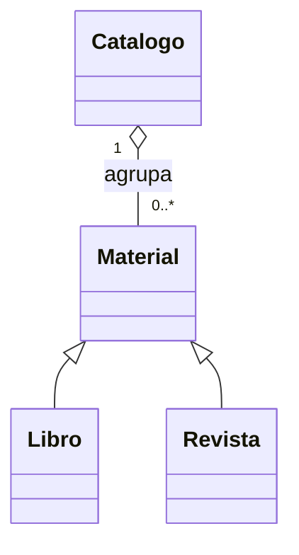
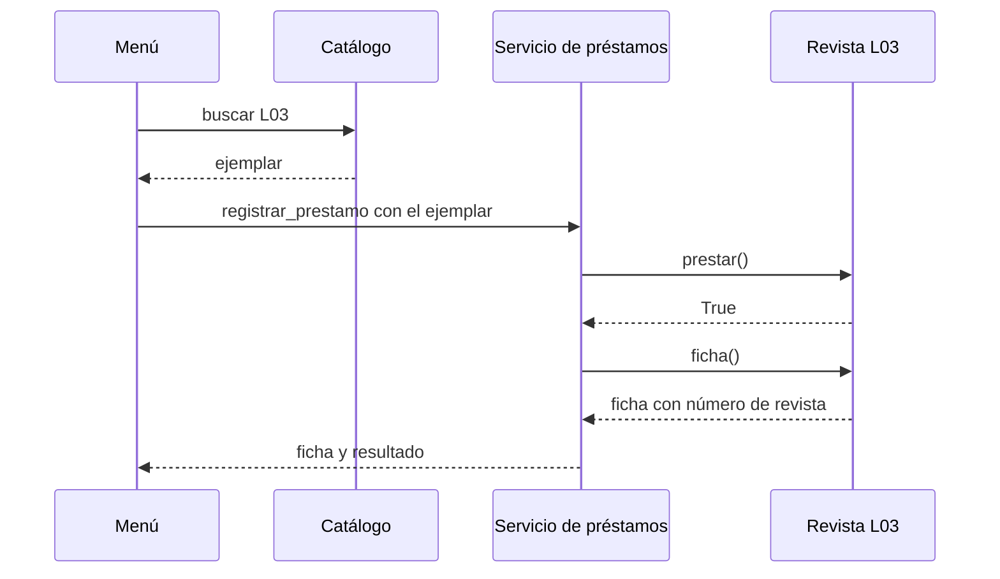

# Taller 02 · Una biblioteca que también presta revistas

**Apartados 5, 6 y 7 del manual de POO · 3 h 45 min orientativas · Python 3.10 o posterior.**

El centro quiere incorporar revistas y audiolibros al catálogo. El personal seguirá buscando los ejemplares por código y usando el mismo menú para prestarlos. Tu trabajo consiste en ampliar la aplicación conservando los préstamos que ya funcionaban. En cada ejercicio anota una predicción, ejecuta la comprobación y guarda la versión que funciona antes de pasar al siguiente.

| Recorrido | Ejercicios | Tiempo |
|---|---|---:|
| [Herencia y composición](#herencia-y-composición) | 1. Extraer lo común · 2. Especializar una revista · 3. Reunir los ejemplares | 80 min |
| [Polimorfismo](#polimorfismo) | 4. Un catálogo, varias fichas · 5. Incorporar audio · 6. Un objeto invitado | 65 min |
| [Una aplicación organizada](#una-aplicación-organizada) | 7. Dividir el programa · 8. Turno de mostrador | 80 min |

## Herencia y composición

### 1. ¿Qué se puede mover sin romper un préstamo? · 25 min

Recupera tu clase del taller anterior. Ejecuta estas comprobaciones antes de tocarla. Si tu aplicación ya tiene menú, hazlas en un archivo de prueba.

```python
a = Libro.desde_linea("L01;Dune")
b = Libro("L02", "Dune")
assert a.prestar()
assert not a.prestar()
assert b.disponible
assert a.devolver()
assert not a.devolver()
```

Crea la clase base `Material`. Mueve a ella el código de inventario, el título, el estado interno, la propiedad de lectura y los métodos de préstamo y devolución. Para este taller, **todos los materiales comparten las etiquetas L01–L99**. La L pertenece al sistema de inventario del centro. Puedes reutilizar el validador del taller anterior en la clase base. Conserva en `Libro` la lectura de las líneas de escáner con dos campos. Añade a `Material` un método `ficha()` que devuelva código y título con el formato `L01 · Dune`. Conserva también los métodos que ya usa tu menú, como `resumen()`.

**Comprueba.** Repite el bloque inicial y añade `assert isinstance(a, Material)` y `assert type(a) is Libro`. Dibuja una flecha desde la llamada `a.prestar()` hasta la clase en la que Python encuentra el método. ¿A qué objeto apunta `self` al ejecutarlo?

### 2. El número de la revista · 25 min

Define `Revista(Material)`. Recibirá `codigo`, `titulo` y `numero`. Para las pruebas, el número será un entero. Delega la inicialización común mediante `super().__init__(codigo, titulo)` y exige un número mayor que cero. Sobrescribe `ficha()` reutilizando `super().ficha()` y añadiendo el número de la revista.

| Operación | Resultado esperado |
|---|---|
| Crear `Revista("L03", "Ciencia hoy", 7)` y consultar su ficha | `L03 · Ciencia hoy · n.º 7` |
| Prestarla y consultar su disponibilidad | El préstamo devuelve `True` y la disponibilidad pasa a `False` |
| Crear el número 0 | Se lanza `ValueError` |
| Crear una revista con código L00 | Se aplica la validación común y se lanza `ValueError` |

**Investiga.** En una copia, omite la llamada al inicializador de la base. Intenta consultar la disponibilidad de la revista. Identifica el atributo que falta y explica por qué el error aparece al consultarlo. Recupera la versión correcta.

### 3. ¿A quién pertenece la colección? · 30 min

Adapta la clase que gestiona tu biblioteca. En este enunciado la llamaremos `Catalogo`. Cada catálogo tendrá una colección propia. Implementa `agregar(material)`, que rechaza códigos repetidos con `ValueError`, y `buscar(codigo)`, que devuelve el ejemplar almacenado o `None`. Guarda el objeto recibido para que cualquier préstamo sea visible desde el catálogo.



**Prueba con dos catálogos.** Añade un libro al primero, recupéralo y préstalo. Comprueba que el libro original ha cambiado de estado, que el segundo catálogo sigue vacío y que una revista con el mismo código es rechazada sin reemplazar el libro. Explica por qué una revista hereda de `Material` y un catálogo guarda referencias a materiales.

## Polimorfismo

### 4. Un catálogo, varias fichas · 20 min

Añade `fichas()` al catálogo. Debe devolver una lista de cadenas en orden de alta. En el recorrido llama a `material.ficha()` para todos los elementos. La elección del formato corresponde a cada objeto.

```python
catalogo = Catalogo()
catalogo.agregar(Libro("L01", "Dune"))
catalogo.agregar(Revista("L03", "Ciencia hoy", 7))
assert catalogo.fichas() == [
    "L01 · Dune",
    "L03 · Ciencia hoy · n.º 7",
]
```

**Predice y depura.** Pon un punto de interrupción en la llamada a `ficha()` dentro del recorrido. En cada vuelta anota el tipo de la instancia, la implementación en la que entras y el texto devuelto. En la segunda vuelta sigue también la llamada a `super()`. ¿Cuántas implementaciones participan al componer la ficha de la revista?

### 5. La prueba del audiolibro · 25 min

Llega un formato nuevo. Implementa `Audiolibro(Material)` con una duración positiva en minutos y una ficha como `L04 · El camino · 95 min`. Utiliza el catálogo del ejercicio 4 y añade ese ejemplar. La única incorporación necesaria en el recorrido de prueba debería ser el alta del audiolibro.

**Criterio de éxito.** El mismo listado devuelve tres fichas distintas. El audiolibro se presta y devuelve usando los métodos comunes. Una duración de cero se rechaza. Si has añadido una condición como `if isinstance(material, Audiolibro)` en el listado, localiza qué decisión de formato puedes trasladar a la clase nueva.

### 6. Una ficha invitada · 20 min

El centro quiere imprimir junto al catálogo una ficha informativa del horario. Define `Aviso`, una clase independiente con un método `ficha()` que devuelva `Horario · lunes a viernes`. Escribe una función `imprimir_fichas(elementos)` que recorra lo que recibe e imprima el resultado de cada llamada a `ficha()`.

Pásale una lista con un libro, un aviso y una revista. Predice las tres líneas y ejecútala. Después cambia temporalmente la firma del aviso por `ficha(self, idioma)` y repite. Anota el tipo de excepción y explica qué requisito de la función incumple ahora el aviso. Restaura la firma original.

**Pregunta de diseño.** El aviso puede aparecer en el informe. ¿Qué operación le faltaría si el mostrador intentara prestarlo? Escribe por separado el acuerdo mínimo para imprimir una ficha y el que necesita el servicio de préstamos. Este ejercicio ilustra el *duck typing*.

## Una aplicación organizada

### 7. Del archivo único al paquete · 35 min

Distribuye el código que ya funciona en esta estructura. Coloca los ejemplos y comprobaciones fuera de los módulos que definen las clases.

```text
proyecto/
├── main.py
└── biblioteca/
    ├── __init__.py
    ├── modelos.py       # Material, Libro, Revista y Audiolibro
    ├── catalogo.py      # Catalogo
    └── prestamos.py     # registrar_prestamo
```

Deja vacío `__init__.py`. En `prestamos.py`, importa `Material` con `from .modelos import Material` e implementa `registrar_prestamo(material: Material) -> str`. Llama una sola vez a `material.prestar()` y utiliza su resultado para devolver la ficha seguida de ` · préstamo aceptado` o ` · préstamo rechazado`. ¿Por qué una segunda llamada dentro de la misma operación produciría un resultado engañoso?

En `main.py`, importa las clases y la función mediante nombres completos, por ejemplo `from biblioteca.prestamos import registrar_prestamo`. Crea un objeto de cada tipo y ejecuta el listado. Agrupa el arranque en una función `main()` e invócala bajo `if __name__ == "__main__":`.

**Comprueba desde la carpeta proyecto.** Ejecuta `python3 main.py` y verifica el listado. Ejecuta después `python3 -c "import main; import biblioteca.prestamos"`: debe terminar sin abrir el menú ni imprimir el listado. En Windows puedes usar `py` en lugar de `python3`.

### 8. Turno de mostrador · 45 min

Conecta las piezas con el menú del ejercicio 18. Prepara un catálogo inicial con los tres ejemplares de los ejercicios 4 y 5. Ofrece listar, prestar por código, devolver por código y salir. Para prestar, busca el objeto y entrégalo a `registrar_prestamo`. Para devolver, utiliza el booleano de `devolver()` para informar de si se realizó la operación. Si el código es desconocido, muestra un mensaje que permita seguir trabajando.



| Prueba de aceptación | Qué debe observar el personal |
|---|---|
| Listar al abrir | Libro, revista y audiolibro con sus tres formatos |
| Prestar L03 dos veces | Primera operación aceptada, segunda rechazada. Ambas identifican el número de revista |
| Prestar L01 después | El libro sigue disponible para su primer préstamo |
| Devolver L03 dos veces | Primera devolución aceptada, segunda rechazada |
| Buscar L99 para prestarlo y listar de nuevo | Mensaje de código desconocido y tres fichas intactas |
| Prestar L04 y salir | El mensaje incluye la duración y el menú termina |

**Entrega individual.** Entrega la carpeta ejecutable y la tabla anterior con tus resultados observados. Elige una llamada realizada desde el menú y explica en cuatro líneas qué módulo la inicia, cómo llega al ejemplar, dónde se selecciona el método y qué dato vuelve al usuario.

<details>
<summary>Autocorrección al terminar</summary>

- **Herencia.** Puedes señalar una única implementación de la regla de préstamo. Prestar una revista modifica esa instancia, incluso cuando el método se encuentra en Material.
- **Composición.** Recuperar y prestar el objeto guardado cambia el estado del mismo ejemplar que entregaste al catálogo.
- **Polimorfismo.** Al añadir Audiolibro, el listado llama al mismo método de siempre y obtiene el formato nuevo. Para imprimir, el aviso solo necesita cumplir el acuerdo de ficha().
- **Organización.** Se puede importar el servicio sin interacción. El menú obtiene un objeto por código y entrega ese objeto al servicio. El servicio conoce la operación de préstamo y cada clase sabe presentar su ficha.

</details>
